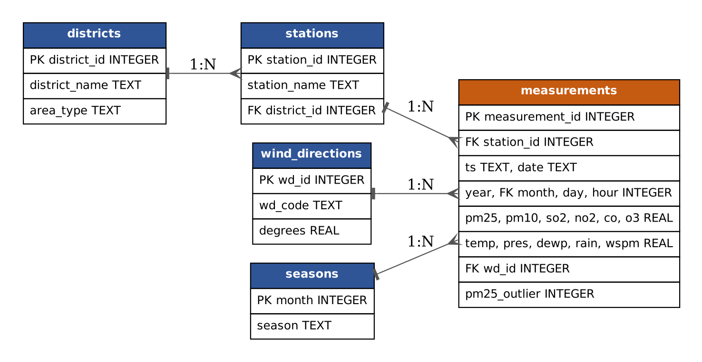

# Air Quality Across Monitoring Sites (Beijing)

Final mini-project, *Programming for Data Analysis and Database* — Cluster 2: Exploratory Analytics, Time Series & Dashboards.

**Team (ADA-2601-2603):** Talant Sakko, Daniyar Yersultanov

**Goal:** study seasonal PM2.5/PM10 variation across 12 Beijing monitoring sites and the influence of weather; compare next-day PM2.5 forecasts against naive baselines.

**Dataset:** [Beijing Multi-Site Air Quality](https://archive.ics.uci.edu/dataset/501/beijing+multi+site+air+quality+data) (UCI) — 12 CSV files, 420,768 hourly rows, 2013-03-01 – 2017-02-28, 18 columns (6 pollutants, 5 weather variables, wind direction, station, time).

## Run

```bash
pip install -r requirements.txt
# put the 12 PRSA_Data_*.csv files into data/raw/
jupyter notebook final_project.ipynb   # main notebook: all steps with results and interpretation
python main.py --all          # same pipeline from the console (≈30 s)
python main.py                # interactive console menu
streamlit run dashboard.py    # dashboard with filters (year, region, site, pollutant)
```

Works in a standard console, VS Code, PyCharm, or Google Colab (see the setup cell of the notebook). Put the 12 CSVs or the original `.zip` into `data/raw/`; archives are unpacked automatically.

## Structure

```
final_project.ipynb  main notebook (imports src/ modules, runs every step, interpretation)
main.py            console menu / full pipeline entry point
dashboard.py       Streamlit dashboard
src/config.py      paths, dtypes, station metadata, constants
src/utils.py       timing + memory measurement, JSON I/O
src/loader.py      chunked CSV reading, dtype optimisation, CSV vs Parquet benchmark
src/cleaning.py    data quality audit (missing, duplicates, IQR outliers), cleaning
src/database.py    SQLite schema, loading, 10 SQL queries, ER diagram, Pandas vs SQL benchmark
src/eda.py         descriptive stats, correlations, static + interactive (Plotly) charts
src/timeseries.py  resampling, rolling means, seasonal decomposition
src/forecasting.py naive / seasonal naive / moving average / Linear Regression / Gradient Boosting
src/pipeline.py    steps shared by menu and full run
docs/              ER diagram
reports/figures    charts (PNG, interactive HTML)
reports/tables     CSV/JSON results (audit, benchmarks, SQL outputs, metrics)
```

## Methods

- **Volume handling:** CSVs read with `chunksize=50_000` and explicit dtypes (`float32`, `int8/16`, `category`); memory before/after measured; data stored as Parquet (size and read time compared with CSV).
- **Cleaning:** datetime built from year/month/day/hour; duplicates removed; negative concentrations set to NaN; gaps ≤ 6 h interpolated in time per site; longer gaps left missing. IQR outliers are flagged (`pm25_outlier`), not removed — spikes are real haze episodes.
- **Database:** normalised SQLite schema (`districts`, `stations`, `wind_directions`, `seasons`, `measurements`), 10 queries with JOIN, GROUP BY/HAVING, subqueries, CTEs, window functions (RANK, ROW_NUMBER, LAG, moving AVG).
- **Time series:** daily/weekly/monthly resampling, 7/30/365-day moving averages, additive decomposition (periods 12, 7, 24), seasonal strength per site.
- **Forecasting:** next-day mean PM2.5 per site; train 2013-03 – 2016-02, test 2016-03 – 2017-02 (time split, no shuffling). All features use data up to day *t−1* only; scaler fitted on train only. Metrics: MAE, RMSE, time, peak memory, skill vs naive.

## ER diagram


